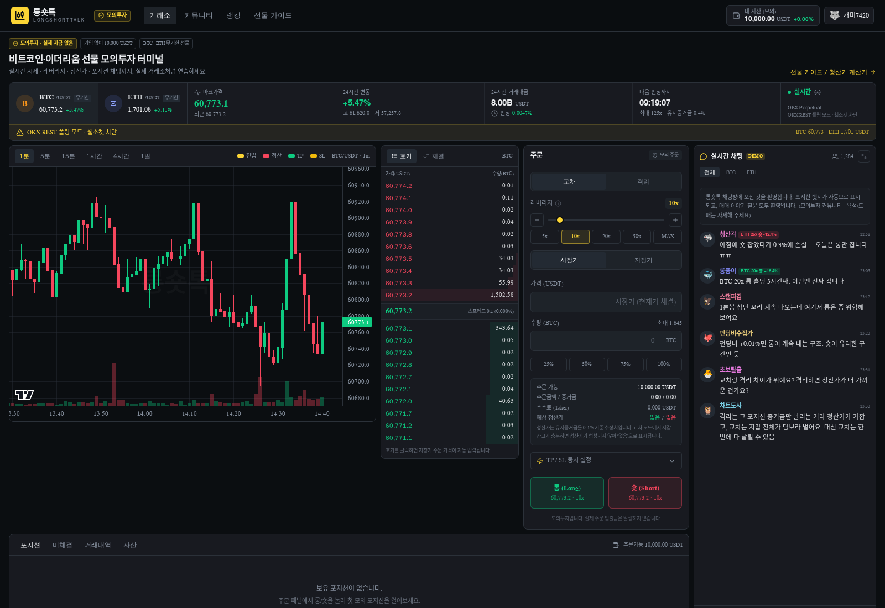
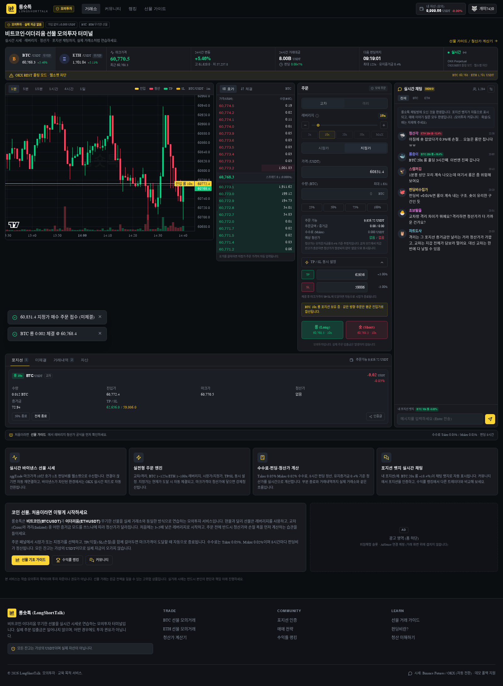
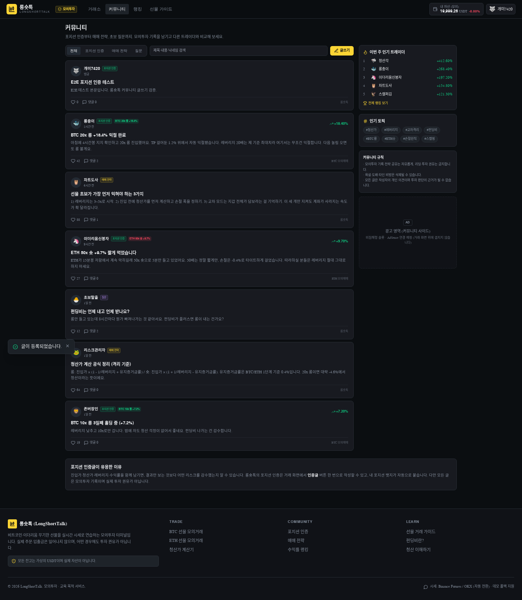
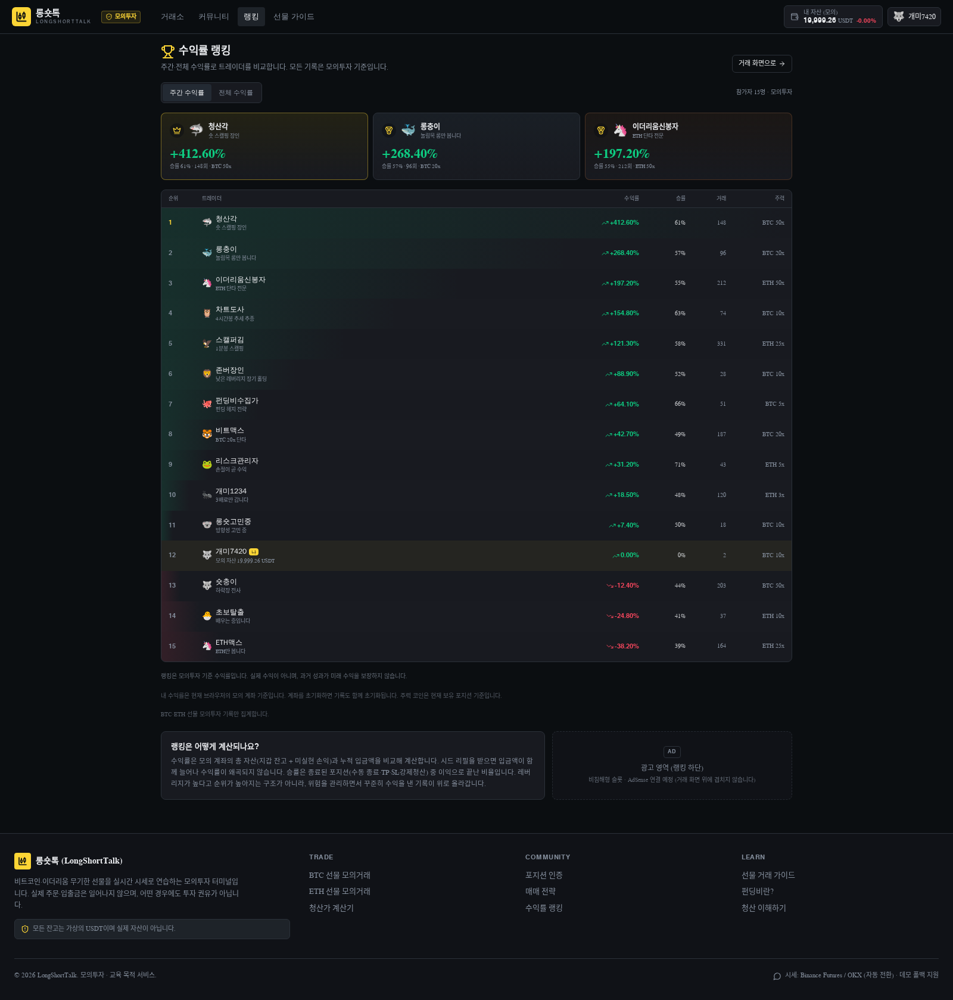
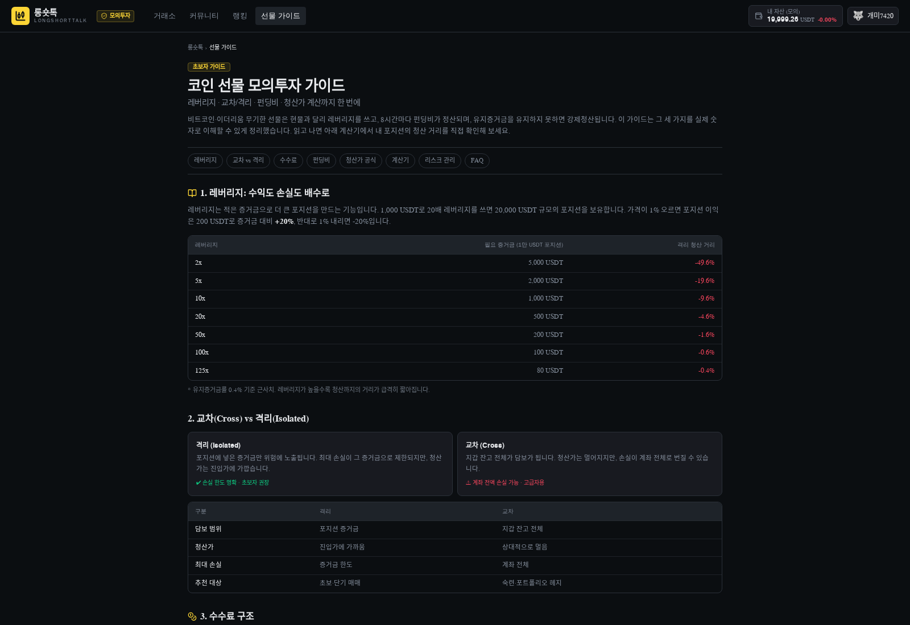
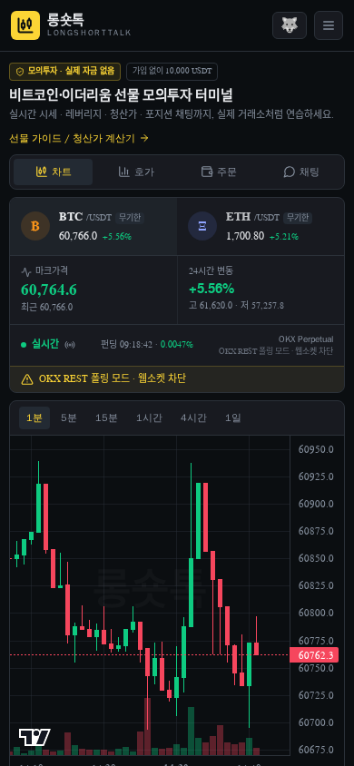
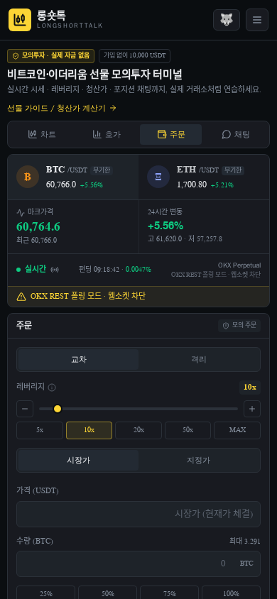

# 📈 롱숏톡 (LongShortTalk)

**비트코인·이더리움 무기한 선물 모의투자 + 실시간 채팅 + 커뮤니티 + 수익률 랭킹**을 한 화면에 담은 웹서비스입니다.
바이낸스 선물 실시간 시세를 받아 실제 거래소처럼 주문·수수료·펀딩·청산을 계산하고, Supabase 없이도 브라우저에서 100% 동작합니다.

> ⚠️ **모의투자 서비스입니다.** 모든 잔고는 가상의 USDT이며 실제 주문·입출금은 발생하지 않습니다. 투자 자문/권유가 아닙니다.



| 거래 · 포지션 | 커뮤니티 |
| --- | --- |
|  |  |

| 수익률 랭킹 | 가이드 & 계산기 |
| --- | --- |
|  |  |

| 모바일 터미널 | 모바일 주문 |
| --- | --- |
|  |  |

---

## ✨ 핵심 기능

### 1) 실전형 선물 거래 터미널 (`/`)
- **다크 트레이딩 UI** — 바이낸스/바이비트 스타일 (`#0B0E11` / `#181A20`, 상승 `#0ECB81`, 하락 `#F6465D`)
- **BTCUSDT · ETHUSDT 전용**, 최대 **125x / 100x** 레버리지
- **교차(Cross) / 격리(Isolated)** 증거금 모드
- **시장가 / 지정가** 주문, **TP(익절) / SL(손절) 동시 설정**, 수량 **25/50/75/100%** 버튼
- **지정가 미체결 주문** → 현재가 도달 시 **자동 체결** (시장성 지정가는 유리한 가격으로 체결)
- **Taker 0.05% / Maker 0.02%** 실제 수수료, 미실현 손익 · ROE% · **청산가 실시간 계산**
- **마크가격 기준 자동 강제 청산**, **8시간 펀딩 정산**, 부분/전체 시장가 종료
- 초기 시드 **10,000 USDT**, 잔고 부족 시 **무료 시드 리필**, 거래내역 · 자산 탭
- 계좌는 브라우저(`localStorage`)에 자동 저장 (Supabase 연결 시 서버 저장으로 확장 가능)

### 2) 실시간 시세 · 차트 · 호가
- **lightweight-charts** 캔들스틱 + 거래량, 타임프레임 `1m · 5m · 15m · 1h · 4h · 1d`
- 현재 포지션의 **진입가 / 청산가 / TP / SL 가격선** 차트 표시
- **10단 호가창** + 체결 내역, 호가 클릭 시 **지정가 가격 자동 입력**
- 상단 바: 마크가격, 24h 변동률·고가/저가·거래대금, **펀딩비 + 카운트다운**, 연결 상태
- **시세 소스 자동 전환**: `Binance Futures` → `OKX Perpetual` → `데모 시세`
  - 웹소켓이 막힌 네트워크에서는 자동으로 **REST 폴링 모드**(수 초 단위)로 전환해 계속 실제 시세를 사용
  - 모든 소스가 불가능할 때만 합성 데모 시세로 동작하며, 화면에 **"데모 시세"**로 명확히 표시

### 3) 실시간 채팅 (`거래 화면 우측 / 모바일 탭`)
- 내 **현재 포지션 뱃지**(예: `BTC 20x 롱 +18.4%`)가 자동으로 붙어 전송됩니다
- 전체 / BTC / ETH 방, 닉네임·이모지 설정, 로컬 저장(데모) 또는 Supabase Realtime(실서비스)

### 4) 커뮤니티 (`/community`)
- **포지션 인증 · 매매 전략 · 질문** 카테고리, 글쓰기/댓글/좋아요/검색
- 거래 화면의 **"인증글"** 버튼 → 포지션 정보가 자동으로 채워진 글쓰기 폼으로 이동
- 인기 트레이더·인기 토픽 사이드바

### 5) 수익률 랭킹 (`/ranking`)
- **주간 / 전체** 수익률 TOP 트레이더, TOP 3 포디움, 승률·거래횟수·주력 코인
- 내 모의 계좌 수익률이 자동으로 표에 합류 (시드 리필은 입금액에 반영되어 왜곡 없음)

### 6) 선물 가이드 & 청산가 계산기 (`/guide`)
- 네이버 검색 유입을 위한 **SSR 텍스트 가이드**: 레버리지, 교차 vs 격리, 수수료, 펀딩비, 청산가 공식, 리스크 체크리스트, FAQ
- **인터랙티브 청산가 계산기** (롱/숏 · 격리/교차 · 레버리지 · 증거금)
- `FAQPage` / `Article` / `BreadcrumbList` **JSON-LD** 구조화 데이터

### 7) SEO · 수익화 준비
- `app/sitemap.ts`, `app/robots.ts`, 페이지별 메타태그, **OpenGraph 이미지**(`public/og.png`), `manifest.ts`(PWA)
- 비침해적 **`AdSlot`** 광고 자리 컴포넌트(홈 하단 / 커뮤니티 사이드 / 가이드 하단) — 거래 버튼 위에 겹치지 않도록 배치
- 네이버/구글 검색에 맞춘 한국어 메타데이터 · 키워드 · 시맨틱 h1/h2 구조

---

## 🧱 기술 스택 (0원 스택)

| 영역 | 사용 |
| --- | --- |
| 프레임워크 | **Next.js 15 (App Router)** · React 19 · **TypeScript** |
| 스타일 | **Tailwind CSS 3** (다크 트레이딩 테마) |
| 차트 | **lightweight-charts 4** (TradingView) |
| 아이콘 | **lucide-react** |
| 데이터 | **Supabase** (Postgres + Realtime + RLS) — *선택* |
| 시세 | Binance Futures / OKX 공개 API (REST + WebSocket) |
| 배포 | **Vercel** 무료 플랜 + Supabase 무료 플랜 |

---

## 🚀 빠른 시작

```bash
# Node.js 20 이상
cd projects/longshorttalk
npm install
npm run dev          # http://localhost:3000
```

환경변수 없이도 바로 실행됩니다. (로컬 데모 모드 + 시세 자동 연결)

```bash
npm run build        # 프로덕션 빌드 (에러 0건 확인)
npm run start
```

### 환경변수 (`.env.example` 참고)

```env
NEXT_PUBLIC_SITE_URL=https://longshorttalk.vercel.app
NEXT_PUBLIC_SUPABASE_URL=
NEXT_PUBLIC_SUPABASE_ANON_KEY=
# auto(기본) | binance | okx | demo
NEXT_PUBLIC_MARKET_SOURCE=auto
```

- Supabase 값이 **비어 있으면** 자동으로 **데모/로컬 모드**: 채팅·커뮤니티·랭킹이 브라우저에 저장되고 즉시 동작합니다.
- 값을 넣으면 채팅·커뮤니티가 **Supabase Realtime**으로 전환됩니다.

---

## 🗂 파일 구조

```
longshorttalk/
├─ app/
│  ├─ layout.tsx            # 메타데이터(OG/SEO) · 헤더/푸터 · Providers
│  ├─ page.tsx              # 거래소(터미널) + SEO 섹션 + 광고 슬롯
│  ├─ community/page.tsx    # 커뮤니티
│  ├─ ranking/page.tsx      # 수익률 랭킹
│  ├─ guide/page.tsx        # 선물 가이드 + JSON-LD + 계산기
│  ├─ sitemap.ts · robots.ts · manifest.ts · icon.svg
│  └─ globals.css
├─ components/
│  ├─ trade/                # MarketBar · ChartPanel · TradingChart
│  │                        # OrderBookPanel · OrderPanel · PositionsPanel · TradeTerminal
│  ├─ chat/ChatPanel.tsx
│  ├─ community/CommunityBoard.tsx
│  ├─ ranking/RankingBoard.tsx
│  ├─ guide/LiquidationCalculator.tsx
│  ├─ layout/ · ads/ · providers/
├─ lib/
│  ├─ engine/               # 모의 거래 엔진 (calc · store · types · useAccount)
│  ├─ market/               # 시세 피드 (binance · okx · demo · feed · adapter)
│  ├─ supabase/             # 클라이언트 · 채팅 · 커뮤니티 연동 레이어
│  ├─ local/                # 데모 모드 시드 데이터/저장 (chat · community · ranking)
│  ├─ constants.ts · utils.ts · profile.ts
├─ supabase/schema.sql      # 테이블·RLS·Realtime·랭킹 뷰
├─ tests/e2e.cjs            # Playwright 스모크 테스트(선택)
└─ public/og.png
```

---

## 🧠 거래 엔진 동작 방식 (`lib/engine`)

| 항목 | 구현 |
| --- | --- |
| 수수료 | 시장가 Taker **0.05%**, 지정가 Maker **0.02%** (진입·청산 각각) |
| PnL | `(마크가 − 진입가) × 수량 × (롱:+1 / 숏:−1)` |
| ROE | `PnL ÷ 포지션 증거금 × 100` |
| 청산가(격리) | 롱 `진입가 × (1 − 1/L + MMR)`, 숏 `진입가 × (1 + 1/L − MMR)` · MMR = 0.4% |
| 청산가(교차) | 지갑 잔고 전체를 담보로 계산(다른 포지션 손익은 단순화) |
| 강제 청산 | 마크가격이 청산가 도달 시 시장가 종료, 격리는 손실이 증거금을 넘지 않음 |
| 펀딩 | 8시간마다 `마크가격 × 수량 × 펀딩비율`, 롱이 +일 때 지불 / 숏이 +일 때 수령 |
| 지정가 | 현재가 도달 시 자동 체결, 시장성 주문은 유리한 가격으로 체결 |
| 저장 | `localStorage`(모의 계좌) — 새로고침해도 유지, 초기화 버튼 제공 |

> 청산가·수수료는 학습용 추정치이며 실제 거래소의 증거금 단계·펀딩·슬리피지에 따라 달라질 수 있습니다.

---

## 🔌 Supabase 연결하기 (무료)

1. [supabase.com](https://supabase.com) → **New project** 생성 (무료)
2. **SQL Editor** 에 `supabase/schema.sql` 전체를 붙여넣고 실행
   - `profiles`, `positions`, `orders`, `chat_messages`, `posts`, `comments` 테이블
   - RLS 정책, 좋아요 RPC, `weekly_leaderboard` 뷰, Realtime publication 까지 포함
3. **Project Settings → API** 에서 `URL`, `anon public key` 복사
4. 프로젝트 루트 `.env.local` 에 입력

```env
NEXT_PUBLIC_SUPABASE_URL=https://xxxx.supabase.co
NEXT_PUBLIC_SUPABASE_ANON_KEY=eyJhbGci...
```

5. 재배포하면 채팅·커뮤니티가 서버 저장 + Realtime 으로 동작합니다.
   (인증을 붙이려면 Supabase Auth를 켜고 `profiles` 트리거를 그대로 사용하면 됩니다.)

---

## ☁️ Vercel 배포 (0원)

```bash
# GitHub에 올린 뒤
# 1) vercel.com → Add New Project → GitHub 저장소 선택
# 2) Framework Preset: Next.js (자동 감지)
# 3) Environment Variables 에 NEXT_PUBLIC_* 값 등록
# 4) Deploy
```

또는 CLI:

```bash
npm i -g vercel
vercel --prod
```

- 커스텀 도메인 연결 후 `NEXT_PUBLIC_SITE_URL` 을 실제 도메인으로 바꾸면 sitemap/OG가 그 주소로 생성됩니다.
- 네이버 서치어드바이저 / Google Search Console 에 `https://<도메인>/sitemap.xml` 을 제출하세요.

---

## 🧪 검증

- `npm run build` — **에러 0건** (타입 체크 포함)
- 모의 엔진 단위 검증 41개 통과: 수수료·PnL·ROE·청산가(격리/교차)·펀딩·TP/SL·지정가 체결·시드 리필
- Playwright E2E: 실시간 시세 로드 → 시장가/지정가 주문 → TP/SL 체결 → 부분/전체 종료 → 채팅 → 시드 리필 → 커뮤니티 글쓰기 → 랭킹/가이드/모바일 탭
- 스크린샷: `docs/screenshots/`

---

## 🛣 다음 단계 아이디어

- Supabase Auth(이메일/카카오) 로그인 + 계정 동기화
- 실시간 랭킹(Realtime 구독) 및 시즌 리셋
- 주문 체결 알림(Web Push), 소리/진동
- 다중 포지션(헤지 모드), 부분 TP/SL
- AdSense 실제 광고 삽입 및 정책 페이지(개인정보처리방침·이용약관)

---

## ⚖️ 면책

본 서비스는 **교육·모의투자 목적**이며 투자 자문이나 권유가 아닙니다. 선물 거래는 원금 전액을 잃을 수 있는 고위험 상품입니다. 실제 투자 판단과 책임은 이용자 본인에게 있습니다.
